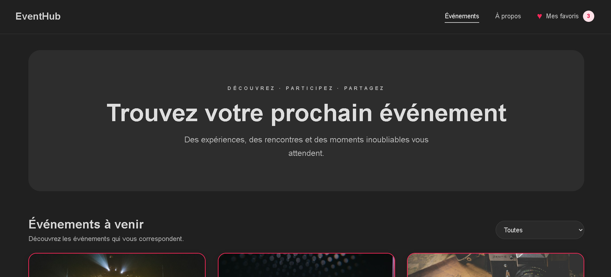
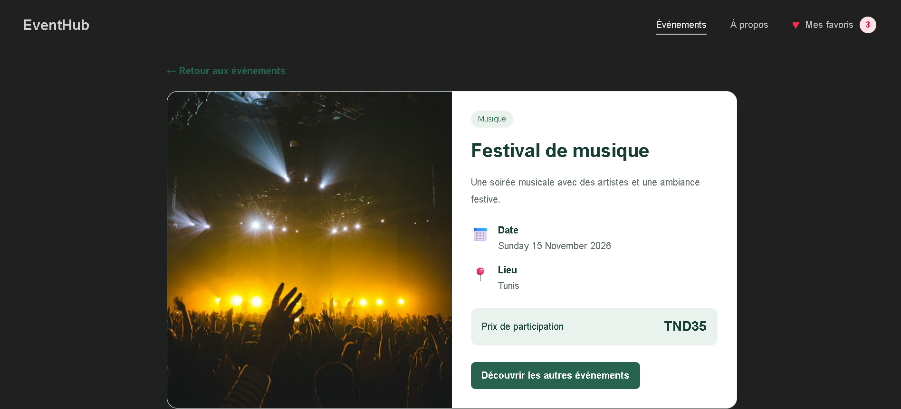
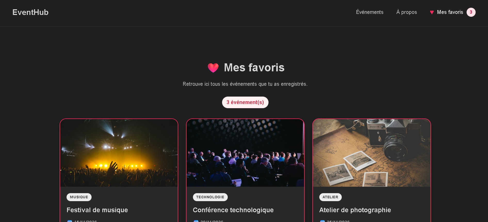

# EventHub — Catalogue d’événements

## 1. Présentation du projet

**EventHub** est une application web développée avec Angular 21 permettant aux utilisateurs de consulter un catalogue d’événements, de filtrer les événements par catégorie, d’afficher les détails d’une activité et de gérer leurs événements favoris.

L'application propose une interface responsive adaptée aux ordinateurs et aux téléphones. Les données des événements sont définies dans le code TypeScript et les favoris sont conservés dans le navigateur grâce à `localStorage`.

## 2. Technologies utilisées

- **Angular 21** : framework de développement frontend.
- **TypeScript** : langage de programmation.
- **HTML5** : structure des pages.
- **CSS3** : mise en forme et responsive design.
- **Angular Signals** : gestion réactive des données avec `signal()`, `computed()` et `update()`.
- **Angular Router** : navigation entre les pages.
- **Git et GitHub** : gestion des versions et hébergement du code source.
- **localStorage** : sauvegarde locale des favoris.

L'application fonctionne côté client. Elle n'utilise ni API externe, ni base de données, ni système d'authentification.

## 3. Fonctionnalités réalisées

- Affichage d'un catalogue d'au moins six événements.
- Présentation des informations : titre, catégorie, date, lieu, prix, image et description.
- Filtrage des événements selon leur catégorie.
- Affichage des détails de chaque événement.
- Ajout et retrait des événements favoris.
- Affichage du nombre de favoris dans la barre de navigation.
- Conservation des favoris après actualisation de la page.
- Navigation entre les pages Événements, Mes favoris et À propos.
- Affichage d'une page NotFound pour les URL inconnues.
- Chargement différé de la page À propos avec `loadComponent()`.
- Interface responsive pour ordinateurs et téléphones.

## 4. Structure du projet

text
src/
└── app/
    ├── components/
    │   ├── header/
    │   ├── event-list/
    │   ├── event-card/
    │   ├── event-details/
    │   ├── favorites/
    │   ├── about/
    │   └── not-found/
    ├── data/
    │   └── events.ts
    ├── models/
    │   └── event.ts
    ├── services/
    │   └── favorites.ts
    ├── app.routes.ts
    ├── app.ts
    └── app.html

### Rôle des composants

- **Header** : affiche le logo et le menu de navigation, avec le compteur des favoris.
- **EventList** : affiche les événements et permet de filtrer les résultats par catégorie.
- **EventCard** : présente un événement sous forme de carte et permet de l'ajouter aux favoris ou de l'en retirer.
- **EventDetails** : affiche les informations détaillées de l'événement sélectionné.
- **Favorites** : affiche les événements enregistrés comme favoris.
- **About** : présente l'application et ses objectifs.
- **NotFound** : affiche un message lorsque la page demandée n'existe pas.
- **FavoritesStore** : centralise la gestion des favoris et leur sauvegarde dans le navigateur.

## 5. Installation et lancement

### Prérequis

Installer Node.js et npm, puis vérifier leur disponibilité :

bash:
node -v
npm -v

Installer Angular CLI si nécessaire :

bash:
npm install -g @angular/cli

Vérifier la version d'Angular CLI :

bash:
ng version

### Cloner le dépôt

bash:
git clone https://github.com/chaima010/eventhub-angular21-Chaima-Dahdouh.git
cd eventhub-ChaimaDahdouh

### Installer les dépendances

bash:
npm install

### Démarrer l'application

bash:
ng serve

Ouvrir ensuite l'adresse affichée dans le terminal, généralement :

http://localhost:4200

Pour tester l'application sur un téléphone connecté au même réseau Wi-Fi :

ng serve --host 0.0.0.0

Utiliser ensuite l'adresse IP locale de l'ordinateur, suivie du port Angular, dans le navigateur du téléphone.

## 6. Principales notions Angular utilisées

### Architecture standalone

Les composants sont autonomes et déclarent leurs dépendances dans la propriété `imports` du décorateur `@Component`.

### Signals

Les Signals permettent de gérer les données réactives :

- `signal()` : stocke une valeur réactive.
- `computed()` : calcule une valeur dérivée.
- `update()` : modifie une valeur à partir de son état précédent.

### Communication entre composants

Le composant `EventCard` reçoit les données d'un événement avec `input()` et signale les actions de l'utilisateur avec `output()`.

### Routage

Angular Router permet d'accéder aux pages suivantes :

| URL | Description |
|---|---|
| `/events` | Liste des événements |
| `/events/:id` | Détails d'un événement |
| `/favorites` | Liste des favoris |
| `/about` | Présentation de l'application |
| Autre URL inconnue | Page NotFound |

La page À propos utilise `loadComponent()` pour le chargement différé.

## 7. Tests manuels

- Vérifier l'affichage de la liste des événements.
- Vérifier le filtrage par catégorie.
- Ajouter et retirer des favoris.
- Vérifier la mise à jour du compteur.
- Actualiser la page et vérifier la conservation des favoris.
- Ouvrir les détails d'un événement.
- Tester un identifiant d'événement inexistant.
- Tester une URL inconnue.
- Vérifier le lien actif dans la navigation.
- Vérifier le chargement différé de la page À propos.
- Tester l'affichage sur ordinateur et téléphone.

## 8. Captures d'écran

1. Page principale avec le catalogue des événements.

2. Page de détails d'un événement.

3. Page Mes favoris.

4. Application en mode responsive sur téléphone.

## 9. Gestion des versions avec Git

Initialiser le dépôt si nécessaire :

git init
git add .
git commit -m "Initialisation du projet EventHub"

Créer la branche principale et configurer le dépôt distant :

git branch -M main
git remote add origin URL_DU_DEPOT
git push -u origin main

Pour publier les modifications suivantes :

git add .
git commit -m "Ajout des composants et gestion des favoris"
git push

Puis, après les tests et la finalisation :

git add .
git commit -m "Finalisation du routage et de la documentation"
git push

10. Conclusion

EventHub met en pratique les principales notions d'Angular 21 : composants standalone, Signals, data binding, communication entre composants, routage, chargement différé et conception responsive. Le projet propose ainsi une application de consultation d'événements simple, fonctionnelle et facile à utiliser.

Auteur :  Chaima Dahdouh
Formation :  Cycle ingénieur en informatique 4ᵉ année, ESPRIT
Année universitaire : 2026/2027